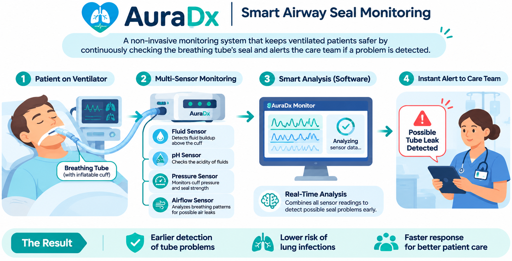
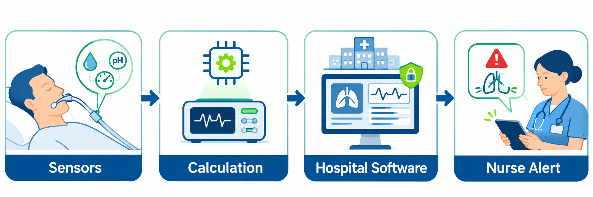

# AuraDx 🫁
### Smart Airway Seal Monitoring

**A BioHack 2026 project | RespAir Medical Devices Challenge**

AuraDx is our proposed system for spotting **possible leaks around a breathing tube** and helping hospital staff respond quickly. It combines sensors, simple calculations, and software alerts.

> **Project status:** Concept and prototype in development. The images show our proposed design, not a finished or clinically tested device. AuraDx is not for patient care or use with a clinical ventilator.

## 1. What problem are we trying to solve?

Some hospital patients need a **ventilator**, a machine that helps them breathe. A breathing tube is placed into their airway. Near the end of the tube is a small inflatable balloon called a **cuff**. The cuff helps create a seal.

If that seal is not good enough, air can escape, and fluids from above the cuff may pass toward the lungs. This can increase the risk of complications, including infection.

**Our goal:** Help nurses notice signs of a possible seal problem earlier. We are **not** trying to replace the ventilator or simply detect whether a patient is breathing.

## 2. Our solution

We plan to combine a small sensor-based device with monitoring software. The device gathers measurements; the software analyzes them and displays an alert if something looks unusual.

**The process:**

1. **Measure:** Sensors collect information near the breathing tube and from available ventilator signals.
2. **Calculate:** A small controller sends measurements to our software, which compares them with expected patterns.
3. **Check:** The software looks for signs of fluid buildup, pressure changes, or possible air leakage.
4. **Alert:** If a possible problem is detected, the dashboard shows a warning. Our longer-term goal is to connect approved alerts to a hospital's nurse notification system.
5. **Review:** Nurses or other trained clinicians assess the situation and decide what to do.

## 3. What sensors are we considering?

| Sensor or data source | What it checks | Why it helps |
|---|---|---|
| **Fluid (capacitive) sensor** | Changes that may indicate fluid collecting above the cuff | Gives an early fluid-buildup signal |
| **pH sensor above the cuff** | How acidic or alkaline the fluid is | Adds information about fluid properties; does **not** identify its exact source |
| **Cuff pressure sensor** | Pressure inside the cuff | Helps track pressure changes; does **not** directly prove a good seal |
| **Ventilator pressure/flow data** | Breathing pressure, airflow, and volume differences | May reveal signs of an air leak |
| **Optional experimental sensor below the cuff** | Changes in fluid properties below the cuff | Research idea only; **not** part of our first physical prototype |

A single unusual sensor reading does **not** prove that the seal has failed. We want to compare several signals to reduce false alarms.

## 4. What will the software do?

Our first software version will:

- Show live sensor readings and simple charts.
- Compare measurements with a baseline.
- Flag possible fluid buildup or air leakage.
- Explain which measurements caused each warning.
- Detect missing or disconnected sensors.
- Save a history of alerts and timestamps.
- Support testing with simulated data before any hardware is connected.

Later, if we have enough reliable labeled data, we may test machine learning to recognize more complex patterns.

## 5. How will nurses receive alerts?

Our proposed alert levels are:

| Status | Meaning | What the software shows |
|---|---|---|
| 🟢 **No abnormality detected** | Available readings are within the configured baseline | Monitoring continues |
| 🟡 **Caution** | An unusual reading, such as possible fluid buildup | A warning with the sensor evidence |
| 🔴 **Possible seal problem** | Multiple measurements suggest a possible leak | A prominent alert for clinical review |
| ⚪ **Sensor fault** | A sensor is disconnected or its data cannot be trusted | A separate equipment/data warning |

**Hospital connection:** Our long-term plan is to send alerts to a hospital's existing nurse notification or monitoring system. For the hackathon, we will demonstrate this with a **mock hospital dashboard or simulated notification**. A real integration would require hospital approval, compatible interfaces, privacy/security controls, and clinical safety testing.

## 6. How we plan to build it

1. **Design the prototype:** Agree on which sensors are practical and what each will measure.
2. **Create simulated readings:** Generate examples of normal conditions, fluid buildup, suspected leaks, and sensor failures.
3. **Build the software:** Use Python for calculations and a dashboard for charts and alerts.
4. **Connect the hardware:** Have a microcontroller, such as an ESP32, send sensor readings to the software.
5. **Test on a safe bench setup:** Use a breathing-tube model or simulator, never a patient.
6. **Improve the alerts:** Measure how often the prototype correctly flags simulated problems and how often it gives false alarms.
7. **Demonstrate hospital notifications:** Show how a simulated alert could reach a nurse-facing screen.

## 7. Technology we plan to use

- **Hardware:** Selected fluid, pH, and pressure sensors; microcontroller (proposed ESP32).
- **Software:** Python for processing and detection.
- **Dashboard:** Streamlit or a web interface for live charts and alerts.
- **Data:** Simulated readings first, then safe benchtop sensor measurements.
- **Integration:** Mock hospital alert interface for the hackathon; real hospital connectivity is future work.

These are planned technologies, not all completed components.

## 8. How we will know it works

We will test several situations: normal readings, fluid collecting without a leak, a simulated seal leak, a ventilator-circuit leak, and a sensor disconnecting. We will measure **detection accuracy, false alarms, and time to alert** on these test scenarios.

The goal is to show that the prototype can recognize useful warning patterns. We will **not** claim it can diagnose aspiration, identify bacteria, prevent pneumonia, or safely monitor real patients without further research and validation.

## 9. Why AuraDx matters

A possible breathing-tube seal problem can be difficult to notice immediately. AuraDx aims to bring information from several sensors into **one easy-to-read screen**, helping care teams see unusual changes and investigate sooner.

**Our vision:** A simple monitoring tool that supports clinicians with clearer information and timely alerts.

---

**Team:** BioHack 2026 — AuraDx  
**Challenge:** RespAir Medical Devices — Hardware & Biosensors  
**Current stage:** Design and research prototype  

*Educational hackathon project. Not a medical device cleared or approved for clinical use.*
