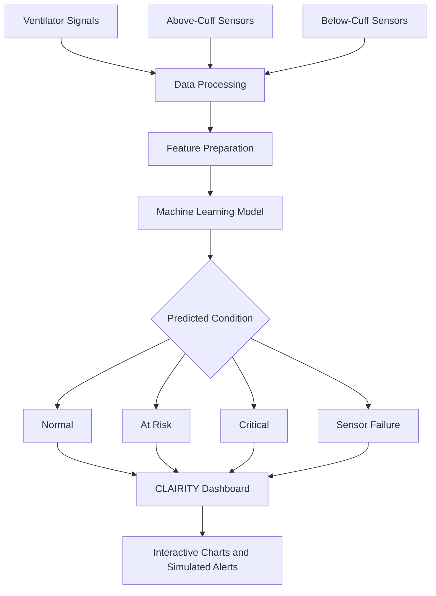
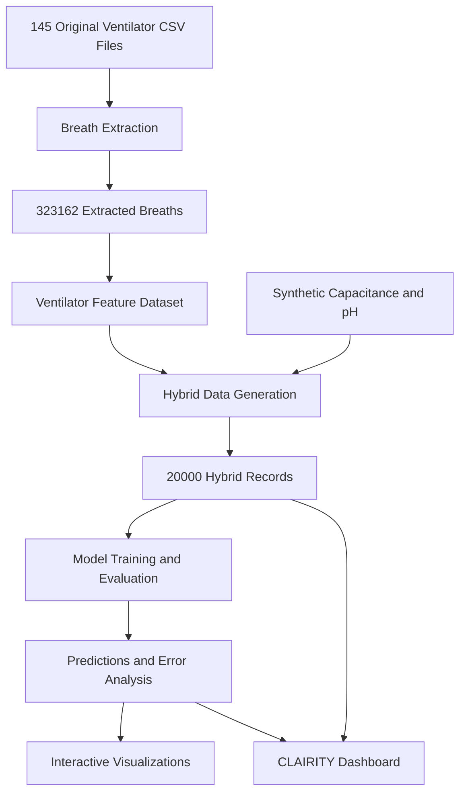
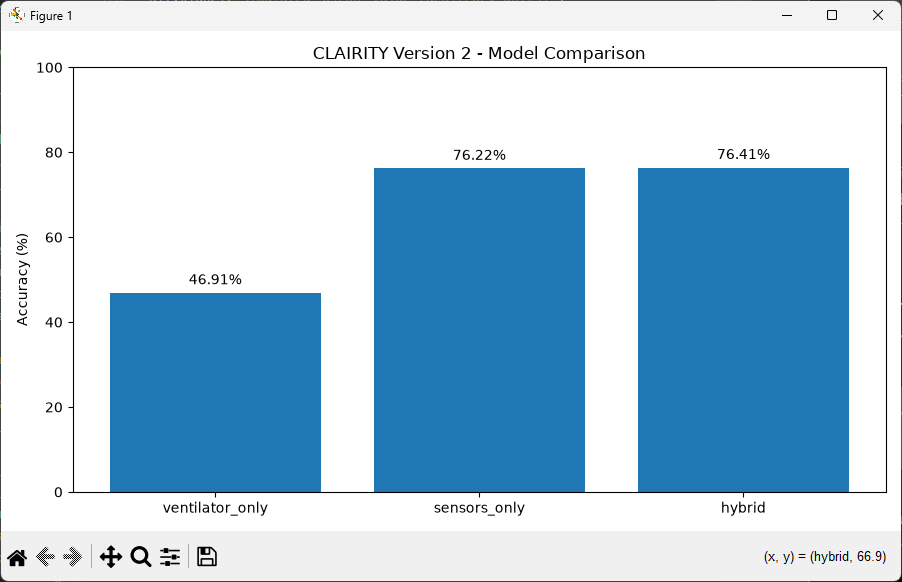
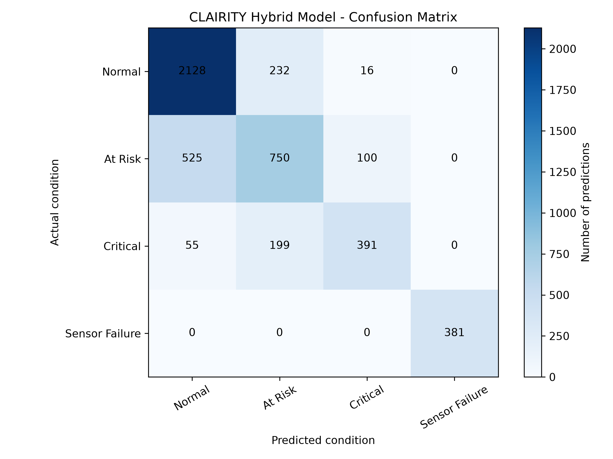
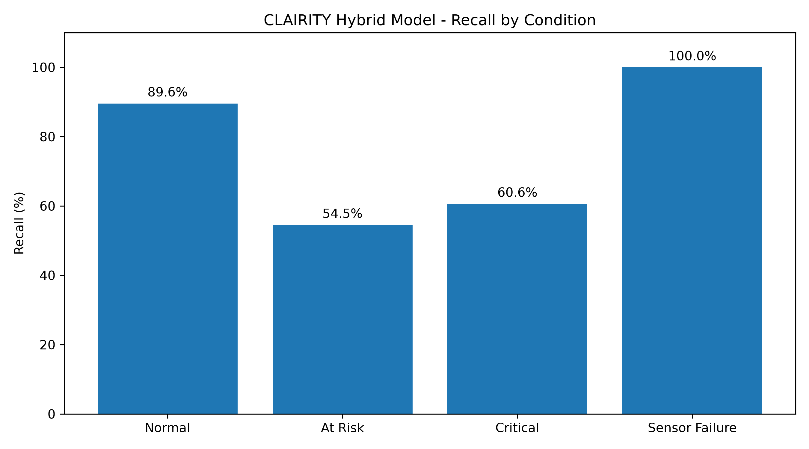
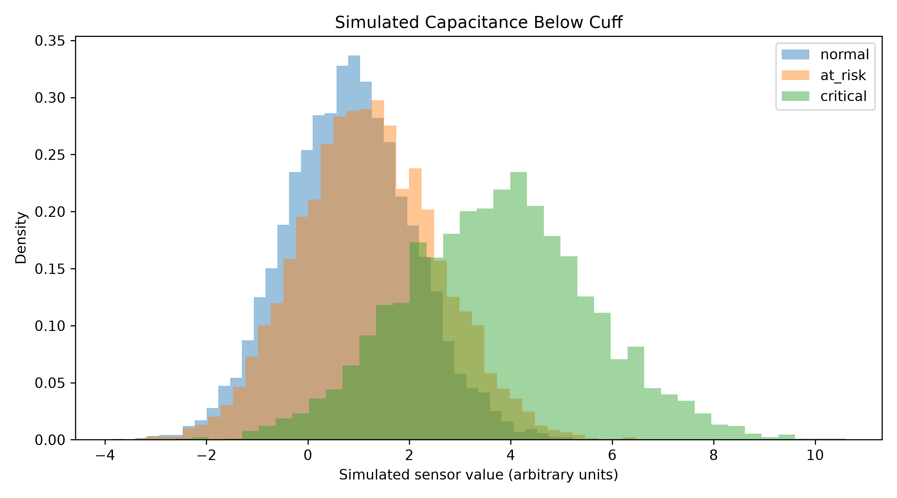

<div align="center">

# CLAIRITY

### Intelligent Airway Monitoring System
**Nucleate Pittsburgh BioHack 2026 | RespAir Medical Devices Challenge**

**A multisensor research prototype exploring the detection of fluid accumulation and possible microaspiration-related patterns around an endotracheal tube cuff.**


[Dashboard](#interactive-dashboard) |
[Results](#machine-learning-results) |
[Interactive Charts](#interactive-visualizations) |
[Installation](#installation)

</div>

> [!IMPORTANT]
> **Research prototype — not for clinical use.**
> CLAIRITY combines features extracted from recorded ventilator data with simulated capacitance and pH measurements. The physical sensor system has not been built or clinically validated. The predictions and alerts are experimental demonstrations, not medical diagnoses.

---

## 1. Project Overview

CLAIRITY is a proposed intelligent airway monitoring system designed to explore how multiple sensor measurements could provide additional information about conditions around an endotracheal tube (ETT) cuff.

During mechanical ventilation, secretions may accumulate above the ETT cuff. Fluid passing around the cuff can contribute to microaspiration, a concern associated with ventilator-associated pneumonia (VAP).

Our proposed system combines:

- Capacitive sensing above and below the cuff
- HPTS fluorescence-based pH sensing above and below the cuff
- Recorded ventilator waveform features
- Machine-learning classification
- A Streamlit monitoring dashboard
- Interactive sensor analysis and simulated alerts

The goal is to investigate whether these different signals can help distinguish potentially concerning patterns in a controlled research simulation.

### Project Objectives

1. Explore fluid accumulation and possible cuff leakage patterns.
2. Combine ventilator information with simulated sensor measurements.
3. Develop a machine-learning classification pipeline.
4. Display sensor trends and predictions through a dashboard.
5. Compare different machine-learning approaches.
6. Analyze prediction errors and limitations.
7. Prepare the software for possible future hardware integration.

---

## 2. Proposed Medical Device

CLAIRITY proposes a multisensor endotracheal tube monitoring system.

| Component | Proposed Function |
|---|---|
| Capacitive sensor above cuff | Monitor changes associated with fluid accumulation |
| Capacitive sensor below cuff | Explore possible fluid movement below the cuff |
| HPTS pH sensor above cuff | Monitor simulated fluid chemistry |
| HPTS pH sensor below cuff | Explore simulated chemical changes below the cuff |
| Ventilator data | Provide respiratory signal context |
| Machine-learning model | Classify experimental sensor patterns |
| Dashboard | Visualize readings, predictions, and alerts |

**Important:** The proposed sensors have not been physically constructed or calibrated. pH and capacitance changes alone cannot confirm aspiration or diagnose pneumonia.

### Proposed Monitoring Workflow



The current software demonstrates this workflow using recorded ventilator features and simulated sensor data.

---

## 3. Data Collection and Processing

### Recorded Ventilator Dataset

The project began with a ZIP archive containing **145 ventilator CSV recordings**.

Our data-processing pipeline produced:

| Metric | Result |
|---|---:|
| Source CSV recordings | 145 |
| Recordings with extracted breath data | 144 |
| Recordings without extracted breaths | 1 |
| Total extracted breaths | 323,162 |
| Columns in breath-level feature dataset | 13 |
| Missing values in extracted feature dataset | 0 |

The processed dataset is:

`data/processed/ventilator_features.csv`

### Extracted Features

For each extracted breath, the project calculates:

- Recording identifier
- Breath identifier
- Number of signal samples
- Signal 1 mean, minimum, maximum, standard deviation, and range
- Signal 2 mean, minimum, maximum, standard deviation, and range

The two signals are named `signal_1` and `signal_2` because their physiological identities and measurement units have not yet been verified against the original dataset documentation.

### Processing Scripts

| Script | Purpose |
|---|---|
| `inspect_ventilator_data.py` | Inspect the original ventilator files |
| `prepare_ventilator_data.py` | Extract breath-level features |
| `check_recordings.py` | Examine recording extraction results |
| `plot_ventilator_data.py` | Generate ventilator visualizations |
| `analyze_ventilator_features.py` | Analyze extracted features |

The original ventilator dataset's source, license, and channel definitions should be verified and cited before public redistribution.

---

## 4. Synthetic Sensor Generation

Because the physical CLAIRITY device has not been built, we generated synthetic readings for four proposed sensors:

1. `capacitance_above`
2. `capacitance_below`
3. `ph_above`
4. `ph_below`

These measurements were combined with extracted ventilator features.

The simulated data includes overlapping values, noise, and missing readings to make the classification task more challenging than the original baseline.

### Experimental Conditions

| Condition | Meaning in the Simulation |
|---|---|
| Normal | Simulated readings without concerning patterns |
| At Risk | Simulated readings associated with possible fluid accumulation |
| Critical | Simulated readings associated with more concerning fluid-related patterns |
| Sensor Failure | Simulated missing or unreliable sensor measurements |

These are synthetic scenario labels, not confirmed patient conditions.

### Hybrid Dataset V2

File: `data/processed/clairity_hybrid_v2.csv`

| Condition | Number of Rows |
|---|---:|
| Normal | 10,060 |
| At Risk | 5,597 |
| Critical | 2,748 |
| Sensor Failure | 1,595 |
| **Total** | **20,000** |

The dataset contains **18 columns**.

For the 1,595 simulated sensor-failure cases, below-cuff capacitance and pH values are missing. This creates an easily recognizable failure pattern and is an important limitation of the experiment.

### Data Pipeline



---

## 5. Machine Learning

We evaluated three machine-learning configurations:

**Ventilator-only model:** Uses extracted ventilator features.

**Sensors-only model:** Uses simulated capacitance and pH measurements.

**Hybrid model:** Combines ventilator features with simulated sensor measurements.

The experiments use a Random Forest classification approach.

### Experimental Split

| Dataset | Rows |
|---|---:|
| Training | 15,223 |
| Testing | 4,777 |
| Total | 20,000 |

**Evaluation caveat:** We still need to verify that recordings are separated between training and testing by `recording_id`. If breaths from the same recording appear in both sets, reported performance may be optimistic. These results are therefore provisional.

---

## 6. Machine Learning Results

### Model Comparison

| Model | Accuracy |
|---|---:|
| Ventilator Only | 40.30% |
| Sensors Only | 75.32% |
| **Hybrid Model** | **76.24%** |

The hybrid model achieved the highest reported accuracy in the current V2 experiment.

Its improvement over the sensors-only model was approximately **0.92 percentage points**.

This suggests that simulated sensor values were the main source of predictive information in this particular experiment. It does not establish the clinical value of either sensor type.



### Hybrid Model Classification Report

| Condition | Precision | Recall | F1 Score | Test Samples |
|---|---:|---:|---:|---:|
| Normal | 0.82 | 0.85 | 0.83 | 2,376 |
| At Risk | 0.61 | 0.59 | 0.60 | 1,375 |
| Critical | 0.71 | 0.68 | 0.69 | 645 |
| Sensor Failure | 1.00 | 1.00 | 1.00 | 381 |

The perfect sensor-failure result should not be interpreted as real-world reliability. The simulated failure cases contain systematic missing-value patterns.

### Confusion Matrix

Rows represent actual simulated labels. Columns represent model predictions.

| Actual / Predicted | Normal | At Risk | Critical | Sensor Failure |
|---|---:|---:|---:|---:|
| Normal | 2,017 | 333 | 26 | 0 |
| At Risk | 418 | 807 | 150 | 0 |
| Critical | 34 | 174 | 437 | 0 |
| Sensor Failure | 0 | 0 | 0 | 381 |



### Prediction Error Analysis

The hybrid model made **1,135 incorrect predictions** out of 4,777 test examples.

Important errors include:

- 418 At Risk cases predicted as Normal
- 333 Normal cases predicted as At Risk
- 174 Critical cases predicted as At Risk
- 150 At Risk cases predicted as Critical
- 34 Critical cases predicted as Normal
- 26 Normal cases predicted as Critical

The 34 Critical-to-Normal errors are particularly important to investigate in future experiments because they represent missed critical patterns within the simulation.



### Earlier Baseline

An earlier rule-based model achieved 99.42% accuracy on 4,800 synthetic readings, and an earlier Random Forest experiment achieved 100% accuracy.

These results were based on much simpler synthetic patterns. We subsequently developed a noisier V2 dataset with overlapping distributions to investigate more realistic classification difficulties.

The original near-perfect scores are not evidence of clinical diagnostic accuracy.

---

## 7. Interactive Dashboard

The CLAIRITY dashboard is built with Python, Streamlit, Plotly, and scikit-learn.

It currently runs locally and provides a live-style simulation.

### Dashboard Features

| Page | Features |
|---|---|
| Live Monitoring | Automatic replay, pause, restart, current sensor values |
| Model Performance | Accuracy comparison, confusion matrix, classification report |
| Sensor Analysis | Interactive sensor distributions and statistics |
| Prediction Errors | Incorrect classifications, filtering, CSV export |

### Live Monitoring

The dashboard automatically advances through existing records and updates:

- Current model prediction
- Above-cuff capacitance
- Below-cuff capacitance
- Above-cuff pH
- Below-cuff pH
- Ventilator feature summaries
- Interactive sensor trends
- Simulated notifications
- Prediction history

**Live replay is not the same as live medical-device acquisition.**

The current dashboard does not receive measurements directly from physical sensors or a hospital ventilator.

### Dashboard Link

The public Streamlit dashboard has not yet been deployed.

After deployment, add the verified Streamlit URL here.

---

## 8. Interactive Visualizations

CLAIRITY includes six Plotly HTML visualizations that support hovering, zooming, and exploring numerical values.

GitHub README files cannot execute interactive Plotly HTML directly. The following links are designed to work after publishing the HTML files through GitHub Pages.

| Interactive Graph | Open |
|---|---|
| Confusion Matrix | [Explore](https://elmehdi02.github.io/CLAIRITY/plots/interactive_confusion_matrix.html) |
| Prediction Errors | [Explore](https://elmehdi02.github.io/CLAIRITY/plots/interactive_prediction_errors.html) |
| Capacitance Above Cuff | [Explore](https://elmehdi02.github.io/CLAIRITY/plots/interactive_capacitance_above.html) |
| Capacitance Below Cuff | [Explore](https://elmehdi02.github.io/CLAIRITY/plots/interactive_capacitance_below.html) |
| pH Above Cuff | [Explore](https://elmehdi02.github.io/CLAIRITY/plots/interactive_ph_above.html) |
| pH Below Cuff | [Explore](https://elmehdi02.github.io/CLAIRITY/plots/interactive_ph_below.html) |

> **Deployment status:** These are intended GitHub Pages addresses, not confirmed working links. Enable GitHub Pages, publish the files, and test each URL before sharing them.

### Sensor Distribution Preview



The synthetic critical cases generally show higher capacitance and lower pH values, but the distributions overlap considerably.

These trends result from the simulation design and have not been confirmed through physical sensor experiments.

---

## 9. Project Structure

```text
CLAIRITY/
|
|-- .streamlit/
|   |-- config.toml
|
|-- data/
|   |-- raw/
|   |-- processed/
|   |   |-- ventilator_features.csv
|   |   |-- clairity_hybrid_v2.csv
|   |   |-- model_comparison_v2.csv
|   |   |-- clairity_hybrid_predictions_v2.csv
|   |-- clairity_model_v2.pkl
|
|-- images/
|   |-- model and sensor visualizations
|
|-- plots/
|   |-- interactive_confusion_matrix.html
|   |-- interactive_prediction_errors.html
|   |-- interactive_capacitance_above.html
|   |-- interactive_capacitance_below.html
|   |-- interactive_ph_above.html
|   |-- interactive_ph_below.html
|
|-- src/
|   |-- data processing scripts
|   |-- sensor generation scripts
|   |-- model training scripts
|   |-- model comparison scripts
|   |-- error analysis scripts
|
|-- app.py
|-- requirements.txt
|-- README.md
```

Additional legacy AuraDx files are retained for the earlier prototype experiments.

---

## 10. Installation

### Requirements

- Python 3.10 or newer recommended
- Streamlit
- Pandas
- NumPy
- Plotly
- Joblib
- Scikit-learn

### Clone the Repository

```powershell
git clone https://github.com/ElMehdi02/CLAIRITY.git
cd CLAIRITY
```

### Create a Virtual Environment

```powershell
python -m venv .venv
.\.venv\Scripts\Activate.ps1
```

### Install Dependencies

```powershell
python -m pip install -r requirements.txt
```

If necessary, install the dashboard dependencies directly:

```powershell
python -m pip install streamlit pandas numpy plotly joblib scikit-learn
```

### Run the Dashboard

```powershell
python -m streamlit run app.py
```

Open the local URL displayed in the terminal.

The processed dataset and trained model must be present in their expected locations for the dashboard to run.

---

## 11. Technology Stack

| Technology | Application |
|---|---|
| Python | Data processing and machine learning |
| Pandas | Data cleaning and feature analysis |
| NumPy | Numerical operations |
| Scikit-learn | Machine-learning classification and evaluation |
| Joblib | Model storage and loading |
| Streamlit | Interactive monitoring dashboard |
| Plotly | Interactive visualizations |
| Matplotlib | Static scientific figures |
| Git and GitHub | Version control and project publication |
| GitHub Pages | Hosting interactive HTML plots |

---

## 12. Limitations

CLAIRITY is an experimental software and medical-device concept.

Current limitations include:

1. The physical sensor device has not been constructed.
2. Capacitance and pH readings are simulated.
3. Experimental labels are synthetic.
4. No clinical ground-truth aspiration measurements are available.
5. Sensor calibration and physical measurement units remain unverified.
6. Ventilator signal channel identities need verification.
7. The model may confuse Normal, At Risk, and Critical conditions.
8. Sensor-failure detection benefits from an artificial missing-value pattern.
9. The training/test split must be checked for recording-level leakage.
10. The dashboard replays existing records instead of receiving live hardware data.
11. Dataset licensing and original source attribution require verification.
12. No patient testing or clinical validation has been performed.

These limitations are essential when interpreting the reported model accuracy.

---

## 13. Future Development

### Machine Learning

- Verify recording-level training and testing separation
- Evaluate models on unseen source recordings
- Improve detection of simulated Critical cases
- Test additional noise and missing-data scenarios
- Evaluate class imbalance and prediction confidence
- Document random seeds and preprocessing assumptions

### Hardware

- Prototype the proposed capacitive sensors
- Investigate HPTS fluorescence-based pH sensing
- Conduct controlled bench testing
- Calibrate sensor measurements
- Explore real-time acquisition interfaces
- Assess sensor reliability and failure behavior

### Software

- Deploy the Streamlit dashboard online
- Publish interactive charts through GitHub Pages
- Add a streaming-data adapter when real hardware becomes available
- Improve event history and monitoring visualizations
- Add reproducible experiment configuration and tests

### Scientific Validation

- Confirm ventilator channel names and units
- Validate the sensor concept in laboratory conditions
- Compare simulated assumptions with physical measurements
- Evaluate safety, reliability, and clinical feasibility before any medical use

---

## 14. Research Ethics and Safety

CLAIRITY is intended for education, experimentation, and prototype development.

The project does not claim to:

- Diagnose aspiration or ventilator-associated pneumonia
- Replace medical professionals
- Provide validated clinical alarms
- Prevent pneumonia
- Monitor real patients
- Demonstrate clinically established accuracy

Any future clinical application would require appropriate engineering verification, safety assessment, ethical review, and regulatory evaluation.

---

## 15. Acknowledgments

Developed for the **Nucleate Pittsburgh BioHack 2026** respiratory medical-device challenge.

The project combines proposed medical-device sensing, data science, machine learning, and interactive software development.

Team members, mentors, original dataset attribution, and scientific references should be added after verification.

---

<div align="center">

### CLAIRITY

**Exploring intelligent airway monitoring through multisensor research and machine learning.**

*Research prototype · Not for clinical use*

</div>
